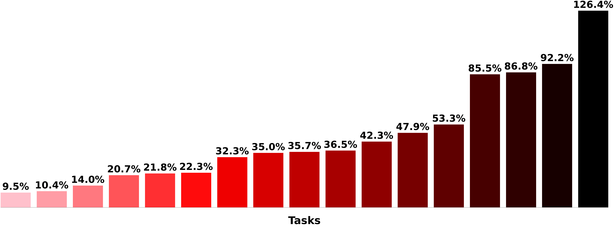

<p align="center">
    <a href="docs/images/all_tasks_30s.png">
        
    </a>
</p>

<h2 align="center">
    <p>Breaking the Performance Ceiling in Reinforcement Learning Requires Inference Strategies</p>
</h2>

<div align="center">


[](https://opensource.org/licenses/Apache-2.0)
[](https://github.com/astral-sh/ruff)
[](https://arxiv.org/pdf/2505.21236)
[](https://sites.google.com/view/inference-strategies-rl)
</div>


This repository contains the official code for the NeurIPS 2025 Oral paper titled:
**Breaking the Performance Ceiling in Reinforcement Learning Requires Inference Strategies**.
The code is built as an extension to the [Mava](https://github.com/instadeepai/Mava) codebase.

## ⚙️ Setup

### 💾 Downloading pre-trained checkpoints
Before running the experiments please download the pre-trained model checkpoints from the following link:
[Download all_checkpoints.zip (~420MB)](https://drive.google.com/file/d/1gehcRmPYCtLLvO1SxKKvs99J9_gJM8ot/view?usp=sharing).
Once downloaded, extract the contents into the root directory of the code and delete the zip file:
```bash
unzip all_checkpoints.zip
rm all_checkpoints.zip
```
After extraction, the code directory should look like this:
```bash
RL-INFERENCE-STRATEGIES/
├── all_checkpoints/
├── base_policy_hyperparameters/
├── inference_configurations/
├── ...
```

### 📦 Installing dependencies
We strongly recommend using `uv` and `python 3.12`, but any other virtual environment manager can be used in a similar way.

```bash
# Install uv
curl -LsSf https://astral.sh/uv/install.sh | sh

# Create a virtual environment and install all dependencies
uv sync

# If you have a GPU, install the CUDA version of JAX
uv sync --extra cuda12

# Activate the virtual environment
source .venv/bin/activate
```

## 🧪 Run experiments
We give convenient launcher scripts to reproduce all the results from the paper.

### 🧠 Train base policies
To retrain all base policies with the parameters used in the paper, please run
```bash
python experiment_launch_scripts/train_base_policies.py
```

### 🧭 Train COMPASS policies
To retrain all COMPASS policies with the parameters used in the paper, please run
```bash
python experiment_launch_scripts/train_compass_policies.py
```

### 📈 Run inference strategy experiments

To run all stochastic evaluation experiments, please run
```bash
python experiment_launch_scripts/eval_stochastic.py
```

To run all COMPASS experiments, please run
```bash
python experiment_launch_scripts/eval_compass_cmaes.py
```

To run all SGBS experiments, please run
```bash
python experiment_launch_scripts/eval_sgbs.py
```

To run all online fine-tuning experiments, please run
```bash
python experiment_launch_scripts/eval_finetuning.py
```

## Citing 📚

If you build on this work, please cite our [paper][paper]:

```bibtex
@inproceedings{chalumeaubreaking,
  title={Breaking the Performance Ceiling in Reinforcement Learning requires Inference Strategies},
  author={Chalumeau, Felix and Rajaonarivonivelomanantsoa, Daniel and de Kock, Ruan John and Formanek, Juan Claude and Abramowitz, Sasha and Mahjoub, Omayma and Khlifi, Wiem and Du Toit, Simon Verster and Nessir, Louay Ben and Shabe, Refiloe and others},
  booktitle={The Thirty-ninth Annual Conference on Neural Information Processing Systems}
}
```

## Acknowledgements 🙏

This work was supported with Cloud TPUs from Google's [TPU Research Cloud](https://sites.research.google/trc/about/) (TRC) 🌤.

[Paper]: https://arxiv.org/pdf/2505.21236
